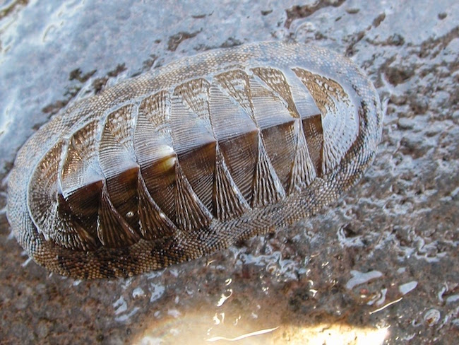

# Effective Population Size  {#sec-effective-population-size .imageChapter}

 

The concept of a "population" is a bit nebulous and up for debate depending upon how you define it and what you are measuring.  This section examines the way in which the size of a population can be estimated and the consequences of how alternative mating systems may influence the distribution of genetic variation within populations.

In the previous section on genetic drift, we showed how the number of individuals in the population is critical to the stability of allele (and by extension genotype) frequencies.  In this section, we examine additional factors that may influence the number of individuals that should be considered when discussing the consequences of genetic drift with respect to conservation and management practices.




