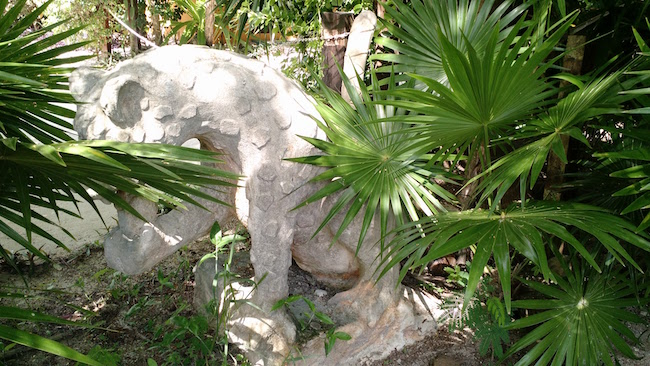
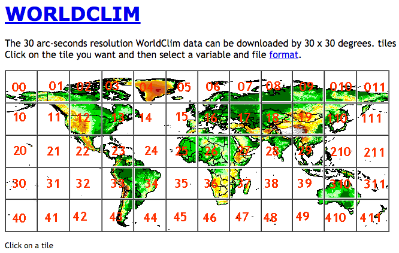

# Raster Data {#sec-raster-data .imageChapter}

<div class="chapter_image"></div>

Rasters are a form of data that is georeferenced and (somewhat) continuous. Raster data is perhaps best envisioned as a matrix of values, whose entries represent spatially referenced data points. The raster itself can be visualized as you could for normal matrix output. What makes a raster different, however, is that it is (or should be) georeferenced. This means that each element of the matrix represents some measurement on the ground having a specific location and spread. This is analogous to an image, where if you zoom in on it enough, you will be able to differentiate between individual pixels, it is just that for rasters, each pixel has a spatial location and size associated with it that we can map onto the earth.

You can either create raster objects *de novo* or you can acquire them from some external source. To create one from scratch, you start with a matrix of values and then construct the raster object using the `rast()` function from the modern **`terra`** library as:

```{r}
library(terra)
r <- matrix(runif(10000),nrow=100)
rnd <- rast( r )
```

which can be visualized using the normal plot command. The `terra` library has overridden several of the plotting functions and you can plot raster objects and decorate the images in the same way you do for normal plotting materials (@sec-graphics).

```{r}
plot(rnd)
```

There are also many available repositories for raster data including Open Source, Governmental, and Municipal locations. One common source for these data is that of http://worldclim.org. This repository contains temperature and precipitation data generalized for the entire globe. 

```{r}

```

These data are available free of charge and have been used in numerous biological studies. Moreover, they provide a set of 'biologically relevant' layers, called `BioClim`, that summarize both temperature and precipitation. They motivate these by saying:

> Bioclimatic variables are derived from the monthly temperature and rainfall values in order to generate more biologically meaningful variables. These are often used in ecological niche modeling (e.g., BIOCLIM, GARP). The bioclimatic variables represent annual trends (e.g., mean annual temperature, annual precipitation) seasonality (e.g., annual range in temperature and precipitation) and extreme or limiting environmental factors (e.g., temperature of the coldest and warmest month, and precipitation of the wet and dry quarters).

These layers are encoded into 19 Bio-layers as defined in @tbl-bioclim. These layers are available for download from their site directly (I recommend using the tiles approach so you do not have to download the entire world map) as well as from the R package [dismo](https://cran.r-project.org/web/packages/dismo/index.html).

```{r}
#| label: tbl-bioclim
#| tbl-cap: "Key to the categories of bioclim variables derived from temperature and precipitation models for current (past and future) conditions. Rasters for these values (in GeoTiff and BIL formats) are available from http://worldclim.org."
df <- data.frame( Layer=paste( rep("BIO",19), 1:19, sep=""))
df$Description = c("Annual Mean Temperature", "Mean Diurnal Range (Mean of monthly (max temp - min temp))", "Isothermality (BIO2/BIO7 * 100)", "Temperature Seasonality (standard deviation * 100)", "Max Temperature of Warmest Month","Min Temperature of Coldest Month", "Temperature Annual Range (BIO5-BIO6)","Mean Temperature of Wettest Quarter","Mean Temperature of Driest Quarter","Mean Temperature of Warmest Quarter","Mean Temperature of Coldest Quarter","Annual Precipitation","Precipitation of Wettest Month","Precipitation of Driest Month","Precipitation Seasonality (Coefficient of Variation)","Precipitation of Wettest Quarter","Precipitation of Driest Quarter","Precipitation of Warmest Quarter","Precipitation of Coldest Quarter")
knitr::kable( df, booktabs=TRUE, longtable=TRUE )
```

For the purposes of this chapter, I'll use bioclim and altitude layers from tile 22, which encompasses the spatial distribution of sampling locations in Baja California for the *Araptus attenuatus* dataset.

Common raster formats include GeoTiff, essentially an image file with some metadata associated with it, and BIL (Binary interleaved) file formats. Both of these types are available from WorldClim. In general, the GeoTiff format is slightly easier to work with as all the data is contained within a single file, whereas the BIL format has two files for each raster (the second file is a header file that has the spatial meta data associated with it). If you do use the BIL format, the file path you pass to `rast()` would be of the BIL file, not the header one.

From Worldclim, I downloaded the elevation raster for Tile 22 and can load it into R using the `rast()` function as:

```{r}
alt <- rast("./spatial_data/alt.tif")
alt
```

The `alt` object is summarized here. A couple of things should be pointed out here:
- In total, this is an object with 12,960,000 entries in it! 
- The resolution of each 'pixel' in this representation is 0.008, which is about 30-arc seconds or ~1km. That means that each location in the study area is represented by the same exact value as the surrounding square kilometer. Obviously, if you are working on processes whose spatial scale is relevant less than 1000 m^^2^^, this kind of data is going to be of little value to you. 
- The values within the matrix range from -202 upwards to 5469. This is in meters.

In addition, the raster has a spatial extent and a projection associated with it. For more information on projections see @sec-map-projections.

```{r}
ext( alt )
crs( alt )
```

This elevation raster looks like:

```{r}
plot( alt, xlab="Longitude", ylab="Latitude" )
```


## Cropping Rasters {#sec-cropping-rasters}

Just because we have a large raster does not mean that it is in your best interest to use the entire object. Much of the spatial analyses routines used in population genetics require measurements of intervening distance, either Euclidean or ecological. Many of the routines for estimation of these distances require the estimation of pairwise distance between *all* pixels. For our purposes, the `arapat` dataset does not occur throughout most of this map, so it is in our best interests to use only the portion of the raster relevant to our data rather than the entire thing. 

Here is one way of going this. I first define an extent, which consists of a vector representing the coordinates for `xmin`, `xmax`, `ymin`, and `ymax` (in decimal degrees longitude and latitude) using the `ext()` function. You then `crop()` the raster to that extent.

```{r}
e <- ext( c(-115,-109,22,30) )
baja_california <- crop( alt, e )
plot(baja_california, xlab="Longitude",ylab="Latitude")
```

Lets make this base map a bit more pretty by taking the altitude and estimating the slope of each pixel and the direction it is facing (aspect). From this, we can 'shade' the hills in the map giving it more of a relief view we commonly see in maps. 

```{r}
slope <- terrain( baja_california, v="slope", unit="radians" )
aspect <- terrain( baja_california, v="aspect", unit="radians" )
baja <- shade( slope, aspect, angle=40, direction=270 )
plot(baja, xlab="Longitude",ylab="Latitude", legend=FALSE, col=gray(0:100 / 100))
```

Onto this map, we can plot our populations. For this, we convert the raw coordinates into a spatial simple features (`sf`) object (see @sec-vector-data) and then overlay onto the map using standard plotting methods.

```{r}
library(gstudio)
library(sf)
data(arapat)
coords <- strata_coordinates(arapat)
pts <- st_as_sf(coords, coords = c("Longitude", "Latitude"), crs = 4326)
plot(baja, xlab="Longitude",ylab="Latitude", legend=FALSE, col=gray(0:100 / 100))
plot(st_geometry(pts), add=TRUE, col="darkred", pch=3)
plot(st_geometry(pts), add=TRUE, col="red", pch=16)
```

### Cropping Rasters Via Polygons

It is also possible to crop a raster with a more fine grained approach using a polygon. Here is an example using five points picked around the region of Loreto, BCS (I just grabbed these by looking at Google Earth). You define a polygon by a series of points, the last of which has to be identical to the first one so that the polygon is a closed object and not just a series of points on a crooked line...

```{r}
pts.poly <- rbind( c(-111.5,27.0),
              c(-112.4,26.7),
              c(-111.7,25.7),
              c(-111.1,25.4),
              c(-110.8,26.0),
              c(-111.5,27.0) )
pts.poly
```

From these points, we construct a spatial geometry collection using `st_sfc()` from the `sf` package and then can overlay onto the map.

```{r}
polys <- st_sfc(st_polygon(list(pts.poly)), crs=4326)
plot(baja, legend=FALSE, col=gray(0:100 / 100))
plot(st_geometry(polys), add=TRUE, border="red")
```

To use the polygon to crop the raster, we have to both remove the part of the raster that is not contained within the polygon (`mask`, casting the `sf` object to a SpatVector using `vect()`) and then cut down the remaining raster to change the bounding box to that representing the portion of the data that remains (`trim`). If you do not trim the raster, it will have the same amount of data associated with it as the previous raster (e.g., the underlying data matrix will have 960 rows and 720 columns) but the part that is masked will be represented by `NA` values.

```{r}
loredo <- trim( mask( baja, vect(polys) ) )
plot(loredo, col=gray(0:100 / 100))
```


### Cropping Rasters Via Convex Hull

An analysis common to modern population genetics is that of finding ecological distances between objects on a landscape. The estimation of pairwise distance derived from spatial data is a computationally intensive thing, one that if you are not careful will bring your laptop to its knees! One way to mitigate this data problem is to use a minimal amount raster area so that the estimation of the underlying distance graph can be done on a smaller set of points. 

Cropping by a polygon like demonstrated in the previous example is a 'by hand' approach to estimating a box that roughly encompasses your data points. A more efficient one is one where you simply provide your coordinates and we can estimate a polygon that surrounds those coordinates with the minimal amount of wasted space. This is called a *Convex Hull*, which is kind of like a polygon that is created as if there was a rubber band fit around all your points. It is a minimal area that includes all of your points. 

For this example, I'm going to use the populations found along the peninsula and find the minimal area encompassing those points. 

```{r}
library(gstudio)
library(sf)
data(arapat)
coords <- strata_coordinates(arapat)
baja_coords <- coords[ !(coords$Stratum %in% c("101","102","32")), ]
baja_pts <- st_as_sf(baja_coords, coords = c("Longitude", "Latitude"), crs = 4326)
plot(baja, legend=FALSE, col=gray(0:100 / 100))
plot(st_geometry(baja_pts), add=TRUE, col="darkred", pch=16)
```

The methods for finding the hull and adding a buffer around it are found natively inside the `sf` package. These are highly efficient, standard functions.

```{r}
# Use st_union to group points together before calling st_convex_hull
hull <- st_convex_hull(st_union(baja_pts))
plot(baja, legend=FALSE, col=gray(0:100 / 100))
plot(st_geometry(baja_pts), add=TRUE, col="darkred", pch=16)
plot(st_geometry(hull), add=TRUE, border="red")
```

The function `st_convex_hull()` returns a polygon that has each of our most 'outward' populations on the very edge of the polygon. It may be beneficial for us to add a buffer around this polygon using `st_buffer()`:

```{r}
hull_plus_buffer <- st_buffer(hull, dist=0.2)
plot(baja, legend=FALSE, col=gray(0:100 / 100))
plot(st_geometry(baja_pts), add=TRUE, col="darkred", pch=16)
plot(st_geometry(hull_plus_buffer), add=TRUE, border="red")
```

Now, we can mask and trim it to include only the area of interest.

```{r}
pop_hull <- trim( mask(baja, vect(hull_plus_buffer)) )
plot(pop_hull, legend=FALSE, xlab="Longitude", ylab="Latitude", col=gray(0:100 / 100))
plot(st_geometry(baja_pts), add=TRUE, col="darkred", pch=16)
```

This would be a great raster to start looking at ecological separation in since we have removed the extraneous data that would unintentionally cause problems with the distance estimators.

## Modifying Rasters

We can modify rasters just as easily as we can crop them. They are matrices, after all. The square bracket indexing you use for matrices are just as effective as before. 

In the next example, I mask the landscape based upon elevation. I create a copy of the original raster and then make everything whose elevation is less than 500m as missing data. Plotting this over the top of the original raster shows only locations where elevation exceeds this cutoff. 

```{r}
bc <- baja_california
bc[ bc < 500 ] <- NA
plot( baja_california, legend=FALSE, col="darkgrey" )
plot( bc, add=TRUE, legend=FALSE)
```

## Extracting Point Data From Rasters

So far, rasters have been confined to representing a single static object. However, it is not uncommon to need to query a raster and find out the values at particular points. These points may be pre-defined or they may be dynamic (e.g., you need to point at a location on the map and determine the value there).

For queries of the first kind, we can use the `extract()` function from `terra`. For this I downloaded the average temperature and precipitation rasters from Worldclim.

```{r}
baja_temp <- rast("./spatial_data/bio1.tif")
baja_prec <- rast("./spatial_data/bio12.tif")
```

And then extract the values from each of these layers into the `coords` data we already have set up, using our spatial `pts` object to locate each stratum. Since `terra::extract()` returns a data frame with an ID column, we retrieve the second column to get the raw vector of values:

```{r}
coords$elevation <- extract( baja_california, pts )[,2]
coords$mean_temp <- extract( baja_temp, pts )[,2]
coords$mean_precip <- extract( baja_prec, pts )[,2]
coords[1:10,]
```

A note should be made on the temperature and precipitation values. Temperature is denoted in tenths of a degree Celcius. Though it does get quite hot at times, it does not average 188&deg;C at population 88! Similarly, the units for precipitation are mm (or tenths of centimeters if you will...).

```{r}
library(ggrepel)
coords <- coords[ order(coords$Latitude),]
p <- ggplot( coords, aes(x=Latitude,y=elevation)) + geom_line(color="lightgrey") 
p <- p + geom_point() + ylab("Elevation (m)")
p + geom_text_repel(aes(label=Stratum), color="red") + theme_minimal()
```

The package `ggrepel` provides a pseudo-smart labelling geometry for ggplot allowing you to have labels that are shifted around the points so as to maximize visibility.


### Stacks of Rasters

It is not uncommon to be working with many different raster layers at the same time. Instead of loading them individually, the `terra` library represents both single-layer and multi-layer datasets under the unified **`SpatRaster`** class. We can load multiple files into a single, multi-layer SpatRaster simply by passing a vector of file paths to `rast()`.

```{r}
files <- c("./spatial_data/alt.tif", "./spatial_data/bio1.tif", "./spatial_data/bio5.tif", "./spatial_data/bio6.tif")
bio_layers <- rast( files )
bio_layers
```

Performing operations on a SpatRaster is as easy as performing them on individual layers. Here, I crop them to our extent defined above.

```{r}
e <- ext( c(-115,-109,22,30) )
bio_layers <- crop( bio_layers, e )
plot(bio_layers)
```

From which values may be extracted using normal methods as outlined above. Since we want to pass this to GGally's `ggpairs` plotting, we remove the extracted `ID` column:

```{r}
df <- extract( bio_layers, vect(baja_pts) )
df <- df[ !is.na(df$alt), -1]
head(df)
```

And visualized normally.

```{r}
library( GGally )
ggpairs( as.data.frame(df))
```


## Rasters & ggplot

As is the case with a lot of data types in R, there is a way to use the `ggplot` library to visualize rasters. What you need to do is transform your `SpatRaster` object into a coordinate data frame using the `as.data.frame(..., xy=TRUE)` function for `ggplot`'s `geom_tile()` function. Here is an example.

```{r}
library(ggplot2)
df <- as.data.frame( baja_california, xy=TRUE )
names(df) <- c("Longitude","Latitude","Elevation")
p <- ggplot( df ) + geom_tile( aes(x=Longitude,y=Latitude,fill=Elevation)) 
p <- p + scale_fill_gradientn( colors=c('#a6611a','#dfc27d','#f5f5f5','#80cdc1','#018571'))
p <- p + coord_equal() + xlab("Longitude") + ylab("Latitude") + theme_minimal()
p
```

As usual, we can add additional information to the plot as we would for any other `ggplot` object. Here I'll add the populations and indicate if they have samples in them that are of one species (Pure) or have a mix of the two (Mixed).

```{r}
num.clades <- colSums( table(arapat$Species, arapat$Population) > 0 )
Stratum=names(num.clades)
Species= factor( c("Pure","Mixed")[num.clades] )
tmp.df <- data.frame( Stratum, Species )
sites <- merge( coords, tmp.df )
p + geom_point( aes(x=Longitude,y=Latitude, shape=Species), size=3, data=sites )
```


## 3D Visualization

It is also possible to visualize rasters in 3-space. The library `rasterVis` provides an interface to the `rgl` library to plot a surface. Once installed, these are easy to use for viewing surfaces. Here is an example using the elevation data we have been playing with.

```{r}
#| eval: false
library(rasterVis)
plot3D( baja_california , zfac=0.1)
```


The `zfac` option in the plot is the amount to scale the z-axis (elevation) in relation to the x-axis and y-axis dimensions. It is a bit exaggerated at `zfac=0.1` but you get the idea.


## Saving & Exporting Rasters

There are many situations where you need to save a raster you've manipulated. As these SpatRaster objects are R objects, you can save them directly to the file system using the standard `save()` function as:

```{r}
#| eval: false
save( baja_california, file="baja_california.rda")
```

This will save the raster object to file exactly like it is in your R session. To load it back in you just use `load()` and it is returned just like it was. The benefit to saving these as R objects is that you do not need to change it at all to pick up where you left off.

You may also need to export the raster in a non-R format for external analyses. To do this, you use the `writeRaster()` function. The file extension is used to determine the file format used and R saves it automatically.

```{r}
#| eval: false
writeRaster( baja_california, filename="baja_california.tif")
```
