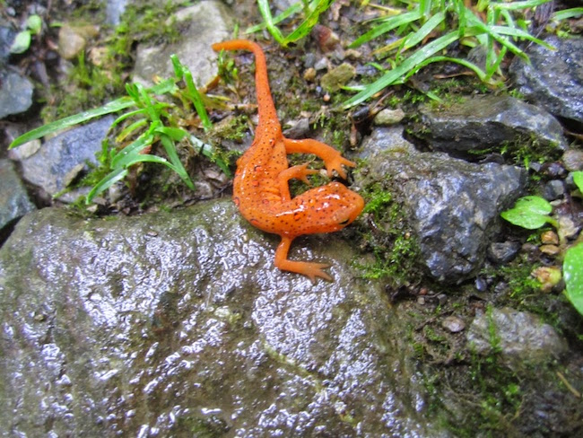

# Vector Data  {#sec-vector-data .imageChapter}

<div class="chapter_image"></div>

For the purposes of this chapter, I will consider vector data as consisting of a finite set of points that may or may not be connected. In `R`, these points can be used directly, as a numeric data type, or as a spatial simple feature object. The **`sf`** (Simple Features) library contains a lot of functions that help deal with points, lines, and polygons, and this is going to be a short overview of how they can be derived and manipulated in the pursuit of population genetic studies.

The older S4-based `sp` package required a rather convoluted set of nested constructions to build spatial objects. The modern standard in the R spatial ecosystem is the `sf` package, which integrates seamlessly with `tidyverse` and standard `data.frame` layouts, making spatial objects much easier to construct, view, and manipulate.

## Points

Points are defined by simple geometries wrapped into a collection of coordinates. In `sf`, we represent spatial geometries as standard `data.frame` or `tibble` objects with an additional list-column called `geometry` that contains the coordinate information.

Let's start by extracting the centroids of the *Arapatus attenuatus* populations from our data set:

```{r}
library(gstudio)
data(arapat)
coords <- strata_coordinates(arapat)
summary(coords)
```

We can easily turn this standard `data.frame` of coordinates into a spatial simple features object (`sf`) using the `st_as_sf()` function. We must specify which columns contain the coordinates and define the coordinate reference system (CRS). In this case, we use the standard WGS84 geographic reference system, which has the EPSG code `4326`.

```{r}
library(sf)
pts <- st_as_sf(coords, coords = c("Longitude", "Latitude"), crs = 4326)
pts
```

Notice that the output shows that it is a standard data frame but with additional spatial attributes: the geometry type (`POINT`), the bounding box, and the coordinate reference system (CRS: `wgs84`).

If we ever need to fetch or redefine the CRS of our spatial object, we can use the `st_crs()` function:

```{r}
st_crs(pts)
```

Any set of x- and y- coordinates can be turned into a spatial `sf` object. Since `sf` objects are standard data frames, associating data with those points is as simple as merging, binding, or adding columns directly to the data frame. 

Let's determine the number of individuals genotyped in each population and add this data to our points:

```{r}
df <- data.frame( table(arapat$Population) )
names(df) <- c("Population","N")

# We can merge this data directly with our sf object (matching "Stratum" to "Population")
pts.df <- merge(pts, df, by.x="Stratum", by.y="Population")
pts.df
```

You can manipulate this spatial object exactly like any other data frame, or you can drop the spatial geometry entirely if you just want a plain data frame:

```{r}
st_drop_geometry(pts.df)[1:5,]
```

Since it is a simple feature object, you can easily fetch spatial properties like the bounding box (the coordinates of a box that encloses all the points) using `st_bbox()`:

```{r}
st_bbox(pts.df)
```


## Lines

Lines are created by linking sequences of coordinate points. In `sf`, we define a line geometry using `st_linestring()` on a matrix of coordinate points, and wrap these geometries in a geometry list-column using `st_sfc()`.

```{r}
# Grab coordinates for first three populations
c1 <- matrix(c(coords$Longitude[1:2], coords$Latitude[1:2]), ncol=2)
c2 <- matrix(c(coords$Longitude[2:3], coords$Latitude[2:3]), ncol=2)

L1 <- st_linestring(c1)
L2 <- st_linestring(c2)

# Create a spatial geometry column with a defined CRS
SLs <- st_sfc(list(L1, L2), crs = 4326)
SLs
```
 
If we want to add data to the set of lines, we can combine our geometry column with a `data.frame` of attributes using the `st_sf()` function:

```{r}
df <- data.frame( Sequence = c("First","Second"), Like_It = c(TRUE, FALSE) )
SLDF <- st_sf(df, geometry = SLs)
SLDF
```

We can also extract the length of each line in meters (or other geographic units) using the `st_length()` function:

```{r}
st_length(SLs)
```


## Polygons 

A polygon is simply a collection of line segments that closes in on itself. We can use polygons to identify habitat, define boundaries, etc. 

To make a polygon, we must close the coordinates, which means taking the first coordinate and appending it to the end of the coordinate matrix, such that the first row is identical to the last row.

```{r}
c <- matrix(c(coords$Longitude[1:5], coords$Latitude[1:5]), ncol=2)
c <- rbind(c, c[1,])

P <- st_polygon(list(c))
P
```

Similar to lines, we can bundle this geometry into a spatial list-column and define the CRS:

```{r}
SPs <- st_sfc(list(P), crs = 4326)
SPs
```

And attributes/data can be added to it easily using `st_sf()`:

```{r}
df <- data.frame(Populations=paste(coords$Population[1:5], collapse=", "))
SPDF <- st_sf(df, geometry = SPs)
SPDF
```


## Saving Vector Objects

As all of these objects are R objects, they can be saved to disk using the standard `save()` function, which makes them a `.rda` object, or we can export them directly to standard spatial file formats (like GeoJSON, Shapefiles, or GeoPackage) using the `st_write()` function from the `sf` package.

```{r}
#| eval: false
st_write(pts.df, "populations.geojson")
```
